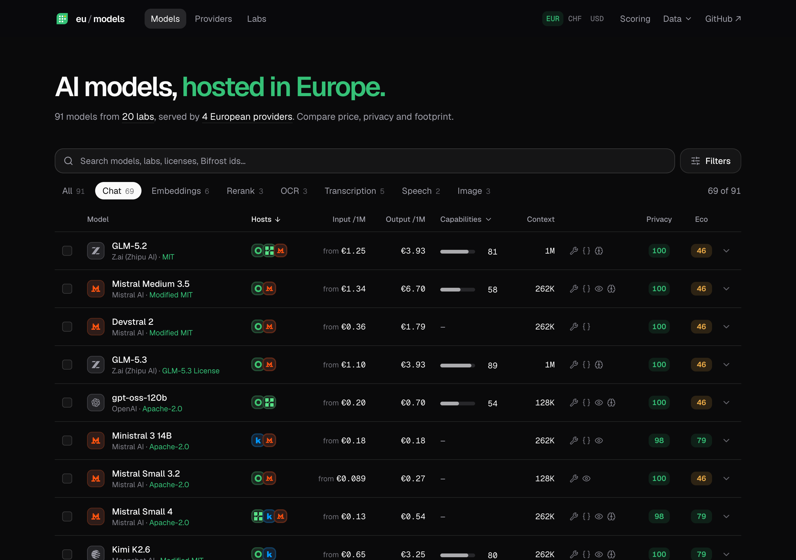
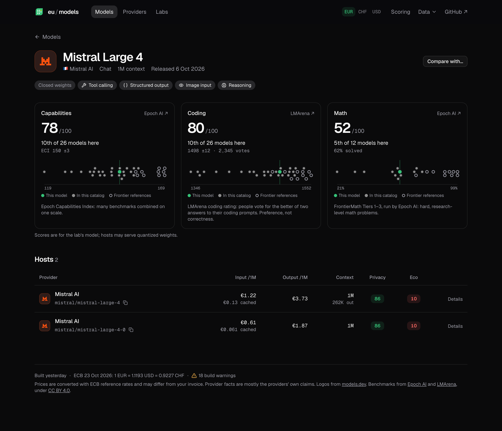
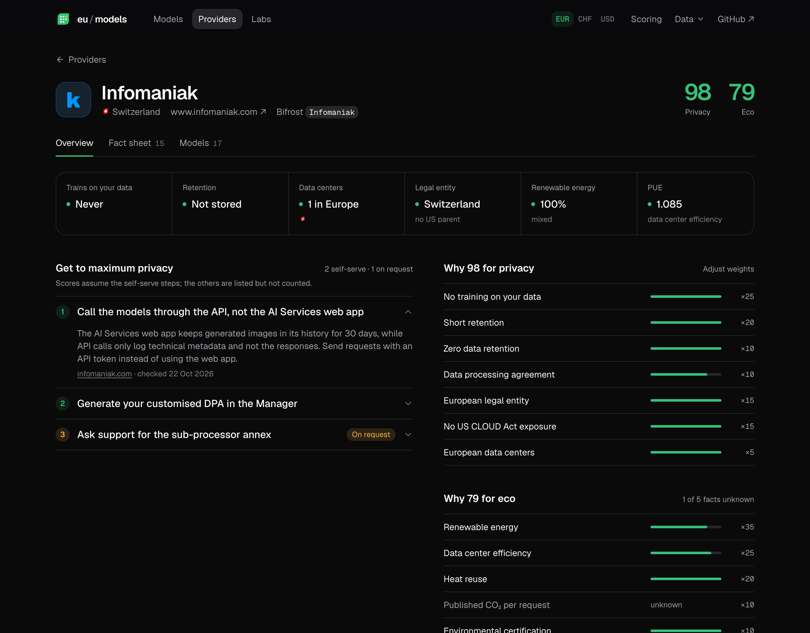
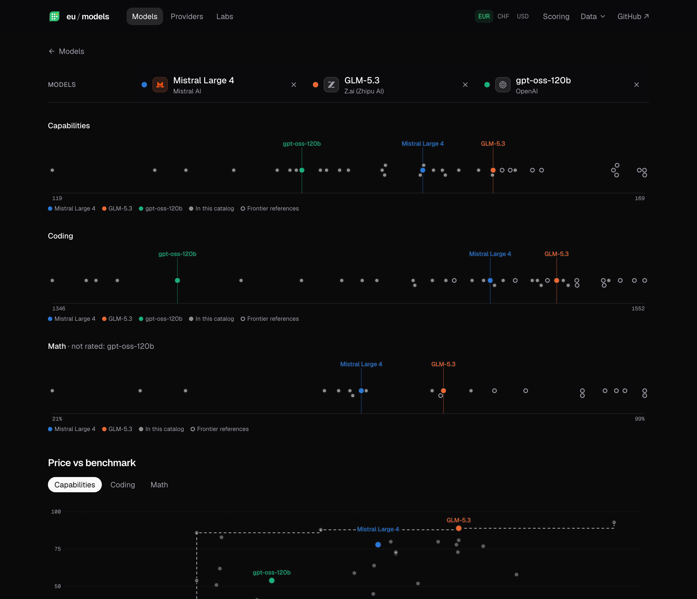

<p align="center">
  
</p>

<h1 align="center">eu/models</h1>

<p align="center">
  AI models hosted in Europe: compare price, privacy and footprint.<br />
  <a href="https://lmgarret.github.io/eu-model-catalog/"><b>lmgarret.github.io/eu-model-catalog</b></a>
</p>

---

A catalog of the AI models served by European providers (GreenPT, Regolo.ai, Infomaniak, Mistral). Prices are pulled from the provider APIs and normalized to USD per token. Each provider gets privacy and eco scores, and each chat model gets benchmark scores.



## What's in it

GitHub Pages publishes three things:

- **The site** (`/`): models grouped across hosts, providers with their privacy and eco scores, AI labs, and a page per model, provider and lab.
- **`pricing.json`**: a pricing datasheet for [Bifrost](#use-with-bifrost)'s `pricing_url`.
- **`catalog.json`**: everything the site shows, with a source for each value.

| Model page | Provider page |
| --- | --- |
|  |  |

Compare up to three models side by side, on benchmarks and on price against benchmark:



See [docs/plan.md](docs/plan.md) for the design.

## Use with Bifrost

```json
"framework": { "pricing": {
  "pricing_url": "https://lmgarret.github.io/eu-model-catalog/pricing.json",
  "pricing_sync_interval": 86400
}}
```

`pricing.json` holds Bifrost's whole default datasheet plus our providers' prices, because `pricing_url` replaces the default. Bifrost matches an entry by model, the entry's `provider` field and `mode`. For custom providers, the `provider` field is the custom provider's name. The names in `providers.yaml` (`bifrost_provider`) must match the provider names in your Bifrost config.

## Data sources

- **Prices**: the provider APIs, plus hand-kept overlays. Converted with ECB reference rates.
- **Provider facts** (privacy, jurisdiction, sustainability): mostly the providers' own claims, each with a source URL and a check date.
- **Benchmarks** (chat models only): [Epoch AI](https://epoch.ai/benchmarks)'s Capabilities Index and FrontierMath, and [LMArena](https://huggingface.co/datasets/lmarena-ai/leaderboard-dataset)'s coding rating, both under CC BY 4.0. Artificial Analysis is not used: its terms forbid republishing its data in a public catalog.
- **Logos**: [models.dev](https://models.dev).

## Local development

Requires Node 22 and pnpm.

```sh
pnpm install
pnpm build        # the site, then dist/pricing.json and dist/catalog.json
pnpm dev          # the site, served with dist/catalog.json (or the published one if missing)
pnpm test         # also: pnpm lint, pnpm typecheck
```

`pnpm build:site` empties `dist/`, so run it before `pnpm build:data`.

No secrets are needed. Without `INFOMANIAK_TOKEN` or `MISTRAL_API_KEY`, those provider APIs are skipped with a warning, and the build reuses their records from the published `catalog.json` when it can. `REGOLO_API_KEY` is optional.

## Project layout

- `providers.yaml` defines the providers: their ids in Bifrost and models.dev, invoice currency, and `lab` when the provider also develops its models. Adding a provider starts there; see the comment at the top of the file.
- `overlay/<provider>.yaml` holds hand-kept prices, written as the provider publishes them. They override every other source. See `overlay/greenpt.yaml` for the format. Overlay entries can also set `canonical` and model facts (`license`, `open_weights`, `tool_call`, …), with or without prices.
- `providers/<provider>.yaml` holds provider facts: privacy, jurisdiction, sustainability and operations, plus `privacy_setup`, the steps to the provider's maximum privacy. A privacy fact can carry a `best` value and the step that unlocks it. Each fact is a claim with a `source` URL and a `checked` date; see `src/facts.ts`. They go to `catalog.json` only, never to `pricing.json`. Facts checked more than 6 months ago raise a `stale_fact` warning and are flagged on the site.
- `labs/<lab>.yaml` holds AI labs (country, EU AI Act status) and their models (license, open weights, Hugging Face repo, aliases). Every hosted model maps to a canonical `<lab>/<model>` id by exact lookups (`src/labs.ts`): the overlay's `canonical`, models.dev's canonical id, the host's own lab, an `<org>/<name>` model id. Unmatched models raise `unattributed_model` or `unknown_lab_model`. Licenses are checked against Hugging Face model cards (`license_mismatch`).
- Benchmarks: a lab model gets scores when `labs/<lab>.yaml` gives its exact name at the source (`epoch`, `lmarena`); names a source doesn't have raise `unknown_benchmark_model`. Models without a name stay blank. Each score keeps its raw value and gets a percentile among every model the source rates (0 for the lowest, 100 for the best), which the site shows, sorts and filters on. Each model's page (`#/models/<lab>/<slug>`) charts it against the catalog's models and reference models: the latest version of each family in `benchmarks.yaml` (Claude, GPT, Gemini), picked at every build, and the best open-weight model (`catalog.json` `benchmarks`).
- `site/` is the site (Svelte 5 + Vite + shadcn-svelte). It reads `catalog.json` only. Scores are computed in the browser from the provider facts (`site/src/lib/scores.ts`); privacy assumes each provider's self-serve maximum-privacy steps. Score weights are kept in localStorage. Add shadcn-svelte components with `pnpm dlx shadcn-svelte@latest add <name>`.
- `test/fixtures/` holds trimmed source responses. To update the snapshot after an intended change, run `pnpm test -u`.
